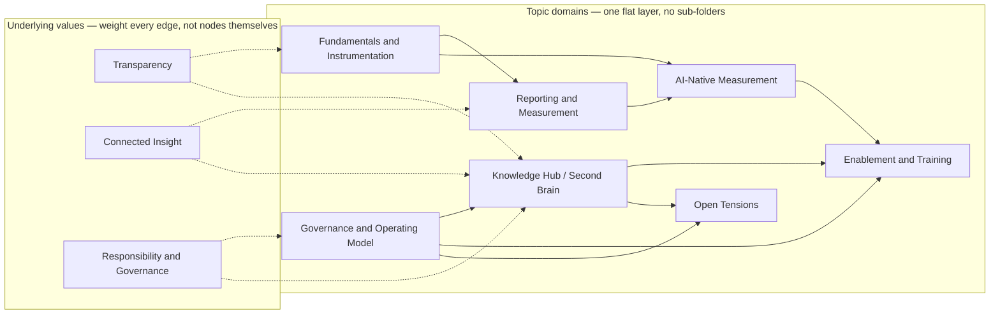

# Product Insights Knowledge Hub

A governed, plug-and-play repository of **finished, reviewed product-analytics findings** — built to be read by people and by the Claude environments they work in.

> Finished findings only. Raw signal, hypotheses, and in-progress work live in a separate "second brain" — not here. The line matters: the first time someone acts on an unverified note pulled from this repo, trust in the whole thing is gone, not just that one note.

---

## Why this exists

The same failure mode repeats across every org I've rebuilt this function in (HelloFresh, Flink, Hotjar, IU): insight lives in one analyst's head, one Slack thread, one dashboard nobody else can parse. The moment that analyst is in a meeting, on leave, or gone, the org re-derives the same finding from scratch — or worse, acts on a stale one.

My role, as I keep landing back on it: **assure the insights are correct, reliable, timely, and accessible.** This repo is the mechanism for that, not a side project.

**How I get to a working version of this in any org** — the audit method:
1. Interview product, design, engineering, and analytics directly — don't start from a doc, start from people.
2. Synthesize the key challenges: what's the history, why did past attempts work or fail, what do people *want* vs. what they *need*, what's the actual maturity level.
3. Understand how the analytics domain overlaps with adjacent ones — growth, finance, product — rather than treating analytics as an island.
4. *(Idea worth building: a Claude skill that scores an audit's output against a defined standard, so "did we do this audit well" isn't just a gut call.)*
5. Build and prioritize a roadmap — 30/60/90, not a five-year plan nobody will reread.

At IU I ran this as a one-person team with no hand-holding; this repo is the piece of that build that's reusable anywhere, not specific to one org's tooling.

---

## The shape of it

Values aren't topics you browse — they're what every connection in this repo is supposed to be made of. The diagram below renders natively on GitHub.

Each node above is **one file** under `/topics/` — not a folder. Sub-points live as sections inside that file. One hop from root to any topic.

| File | Covers |
|---|---|
| [`topics/fundamentals-instrumentation.md`](topics/fundamentals-instrumentation.md) | Data sources, tracking plan, naming, QA, semantic layer, identity resolution, legal/consent |
| [`topics/governance-operating-model.md`](topics/governance-operating-model.md) | Operating model, team growth, prioritization, stack decisions, legacy deprecation, role definition |
| [`topics/reporting-measurement.md`](topics/reporting-measurement.md) | KPI tree, reporting granularity, activation/retention/monetization, experimentation |
| [`topics/ai-native-measurement.md`](topics/ai-native-measurement.md) | Measuring AI activity, conversational analytics, agents, outcome/trust metrics |
| [`topics/knowledge-hub-second-brain.md`](topics/knowledge-hub-second-brain.md) | This repo's own design: scope, governance, why GitHub |
| [`topics/enablement-training.md`](topics/enablement-training.md) | Training, self-serve enablement, skill codification, team growth |
| [`topics/open-tensions.md`](topics/open-tensions.md) | Unresolved questions worth naming rather than hiding |

---

## How to contribute a finding

1. Open a branch, add or edit the relevant file under `/topics/` (or propose a new one if it genuinely doesn't fit an existing domain).
2. Open a pull request. The PR diff *is* the review surface — this is why the repo lives on GitHub and not in a shared drive.
3. An assigned reviewer checks the evidence and framing before merge. No self-certification — this is the one rule that keeps "plug and play" from meaning "plug and play a wrong number into every team's context."
4. Every entry carries author, reviewer, and date. If the underlying metric or event changes later, the entry gets a re-review, not a quiet edit.

Raw signal, hunches, and work-in-progress don't belong here — keep those in your own working notes until they're ready to be a finding someone else can build on.
