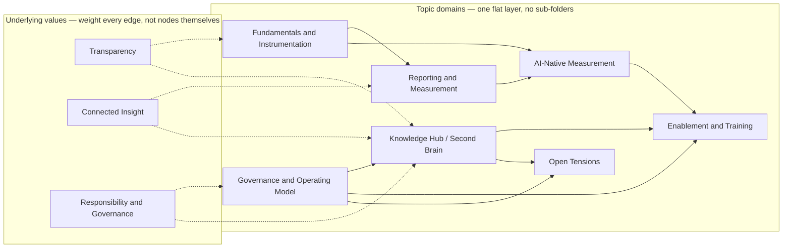

# Product Insights Knowledge Hub

A governed, plug-and-play repository of **finished, reviewed product-analytics findings** — built to be read by people and by the Claude environments they work in.

> Finished findings only. Raw signal, hypotheses, and in-progress work live in a separate "second brain" — not here. The line matters: the first time someone acts on an unverified note pulled from this repo, trust in the whole thing is gone, not just that one note.

---

## Why this exists

The same failure mode repeats across every org I've rebuilt this function in (HelloFresh, Flink, Hotjar, IU): insight lives in one analyst's head, one Slack thread, one dashboard nobody else can parse. The moment that analyst is in a meeting, on leave, or gone, the org re-derives the same finding from scratch — or worse, acts on a stale one.

My role, as I keep landing back on it: **assure the insights are correct, reliable, timely, and accessible.** This repo is the mechanism for that, not a side project.

**How I get to a working version of this in any org** — the audit method:
1. Interview product, design, engineering, and analytics directly — don't start from a doc, start from people.
2. Synthesize the key challenges: what's the history, why did past attempts work or fail, what do people *want* vs. what they *need*, what's the actual maturity level.
3. Understand how the analytics domain overlaps with adjacent ones — growth, finance, product — rather than treating analytics as an island.
4. *(Idea worth building: a Claude skill that scores an audit's output against a defined standard, so "did we do this audit well" isn't just a gut call.)*
5. Build and prioritize a roadmap — 30/60/90, not a five-year plan nobody will reread.

At IU I ran this as a one-person team with no hand-holding; this repo is the piece of that build that's reusable anywhere, not specific to one org's tooling.

---

## The shape of it

Values aren't topics you browse — they're what every connection in this repo is supposed to be made of. The diagram below renders natively on GitHub.

The 7 domains above are a *conceptual* grouping — not a folder you'll find on disk. On disk, everything lives one level under `/topics/`, consistently: either a single file (a topic with no close neighbor), or a small cluster folder (2+ related topics) with its own `README.md` as the index. Never deeper than that.

| Cluster / file (under `topics/`) | Domain | Covers |
|---|---|---|
| `instrumentation-standards/` | Fundamentals | Data sources, tracking plan, naming convention |
| `tracking-ownership-and-qa/` | Fundamentals | Strategy & ownership, QA & unit testing |
| `data-integrity-and-semantics/` | Fundamentals | Data accuracy, semantic layer |
| `identity-and-users/` | Fundamentals | Identity resolution, two-sided users |
| `compliance-and-platform-constraints/` | Fundamentals | Legal/consent, cross-platform, latency/FE-BE/access |
| `action-tracking-vs-ai-tracking.md` | Fundamentals | Why AI interactions need their own tracking pattern |
| `operating-model-and-sequencing/` | Governance | Operating model, sequencing of work |
| `team-and-role-design/` | Governance | Growing the team/embedding, redefining the analyst role |
| `planning-and-prioritization/` | Governance | Backlog/tracking-plan interactions, prioritization techniques |
| `stack-and-legacy-decisions/` | Governance | Deciding on the stack, legacy tracking & deprecation |
| `documentation-standards/` | Governance | Documentation expectations, no silos |
| `how-to-avoid-being-a-helpdesk.md` | Governance | The default failure mode of an under-leveraged function |
| `audit-method.md` | Governance | Pointer to the full audit method in this README |
| `kpi-and-reporting/` | Reporting | KPI tree, key reports |
| `measurement-definitions/` | Reporting | Granularity, how measures are calculated, model backbone |
| `activation-to-monetization-funnel/` | Reporting | Activation window, conversion, retention, monetization |
| `product-catalog/` | Reporting | Features, models |
| `experimentation-and-performance-measurement.md` | Reporting | Clean vs. non-clean experimentation |
| `ai-event-data/` | AI-Native | Measuring AI activity, conversation → event data |
| `ai-automation-surfaces/` | AI-Native | Automations, experimentation platform, morning briefings |
| `omni-and-agent-layer/` | AI-Native | Agents, Omni models, Omni API to Claude |
| `conversational-ux/` | AI-Native | Conversational analytics, new UX vs. prompt-based agents |
| `comparing-ai-and-legacy-features.md` | AI-Native | Outcome-based comparison, not activity-based |
| `trust-and-calibration-metrics.md` | AI-Native | Acceptance rate, override rate, survivorship bias, quality substitution |
| `second-brain-foundations/` | Knowledge Hub | What/why/how, long-term vs. short-term memory |
| `repository-design/` | Knowledge Hub | Insights-not-just-data, centralization, Markdown-in-GitHub |
| `why-github-not-drive.md` | Knowledge Hub | The full rationale, including the honest trade-off |
| `governance-and-trust/` | Knowledge Hub | Scope (finished findings only), review process, freshness |
| `training-and-access/` | Enablement | Training, user access |
| `self-serve-and-growth/` | Enablement | Self-serve enablement, team learning & development |
| `skill-codification.md` | Enablement | Encoding analyst judgment into something reusable |
| `open-tensions/` | Open Tensions | Product Ops boundary, governance vs. speed, org design |

---

## How to contribute a finding

1. Open a branch, add or edit the relevant file under `/topics/` (or propose a new one if it genuinely doesn't fit an existing domain).
2. Open a pull request. The PR diff *is* the review surface — this is why the repo lives on GitHub and not in a shared drive.
3. An assigned reviewer checks the evidence and framing before merge. No self-certification — this is the one rule that keeps "plug and play" from meaning "plug and play a wrong number into every team's context."
4. Every entry carries author, reviewer, and date. If the underlying metric or event changes later, the entry gets a re-review, not a quiet edit.

Raw signal, hunches, and work-in-progress don't belong here — keep those in your own working notes until they're ready to be a finding someone else can build on.

<!-- Paste this as a section into the existing README.md — it is not a standalone repo file. -->

## How to consume this hub

This repo is the source of truth for our finished product-analytics findings. To
put its knowledge into your workflow:

1. **Sync it into your assistant's context** — clone it into your agent's
   workspace (Claude Code / Cowork read `CLAUDE.md` → `AGENTS.md` automatically),
   or add the repo as a knowledge source in a claude.ai Project.
2. **If your tool doesn't auto-read repo files** (e.g. a claude.ai Project), add
   one line to that Project's custom instructions:
   *"Follow the consumption rule in this repo's `AGENTS.md`."* Keep it a pointer —
   don't copy the rule in, so there stays one canonical version.
3. **Then just ask.** For our metrics, definitions, and findings the assistant
   answers from the hub and cites the file; for general method it answers
   normally; if something isn't covered it says so rather than inventing it.

**Rule of thumb:** ground against the hub when the answer must be *our* truth
(specific, consistent, current, auditable); ask plainly when you want general
knowledge or open exploration.